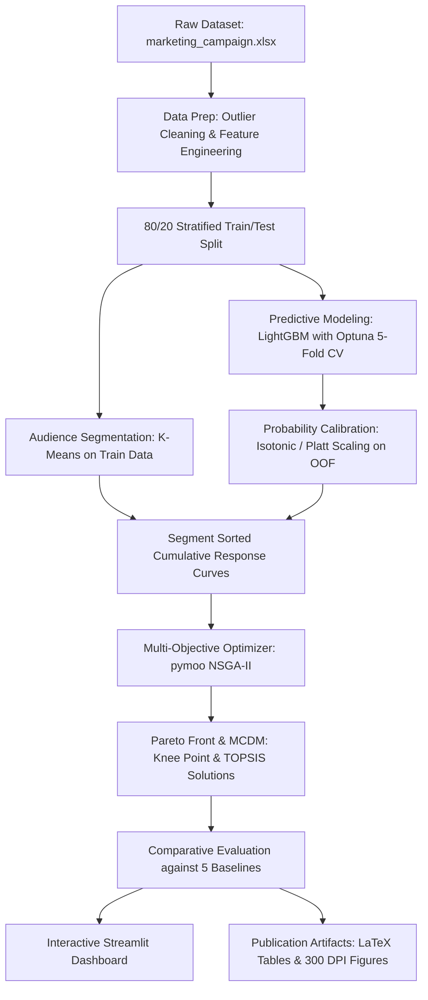

# AI-Driven Multi-Objective Optimization for Digital Marketing Campaigns using LightGBM and NSGA-II

[](https://www.python.org/downloads/)
[](https://opensource.org/licenses/MIT)
[](https://github.com/psf/black)

A complete, end-to-end, reproducible research prototype and decision support system for multi-objective digital marketing campaign optimization. The system predicts customer conversion probabilities with calibrated LightGBM models and optimizes multi-channel budget allocations across competing business objectives (Customer Lifetime Value gain, Return on Investment, budget efficiency, and contact fatigue) using evolutionary NSGA-II algorithms via `pymoo`.

---

## 1. System Architecture



---

## 2. Key Features

- **No Data Leakage Guarantee:** Imputation medians, feature scalers, encoders, and cluster models are strictly fitted on the training split only.
- **Overfitting Safeguards & Calibrated Probabilities:** LightGBM constrained search space tuned via Optuna with 5-fold Stratified CV; genuine Out-of-Fold (OOF) isotonic probability calibration ensures uninflated expected values.
- **Empirical AI Survey Comparison:** Side-by-side benchmark comparing Logistic Regression, Random Forest, XGBoost, CatBoost, and LightGBM on the exact same cross-validation splits.
- **Non-Linear Diminishing Returns Optimization:** Precomputed segment response curves model the empirical law of diminishing returns per segment and channel.
- **Multi-Criteria Decision Making (MCDM):** Automated Knee-point detection and customizable TOPSIS compromise selection.
- **Interactive Web App:** High-performance Streamlit application with interactive Plotly 2D/3D Pareto visualization and real-time customer scoring.

---

## 3. Repository Structure

```text
.
├── config.yaml                  # Central configuration & labeled assumptions
├── requirements.txt             # Pinned dependencies
├── README.md                    # System documentation & reproduction guide
├── pytest.ini                   # Pytest configuration
├── data/
│   ├── raw/
│   │   └── marketing_campaign.xlsx   # Authentic raw dataset (2240 rows, 29 cols)
│   └── processed/
│       ├── train.parquet             # Cleaned training split (80%)
│       ├── test.parquet              # Held-out testing split (20%)
│       └── scored_campaign_data.parquet # Full scored dataset with OOF probabilities & CLV
├── src/
│   ├── __init__.py
│   ├── data_prep.py             # Data cleaning, outlier removal, feature engineering
│   ├── metrics.py               # Pure vectorized marketing formulas (CR, CTR, CPA, ROI, CLV)
│   ├── segmentation.py          # K-Means clustering, elbow/silhouette evaluation
│   ├── model.py                 # LightGBM tuning, OOF calibration, SHAP, model survey
│   ├── optimizer.py             # pymoo NSGA-II multi-objective problem & MCDM
│   ├── baselines.py             # Non-optimized & single-objective allocation baselines
│   ├── evaluate.py              # 2D/3D Pareto plotting, sensitivity analysis, paper numbers
│   └── run_all.py               # One-command end-to-end execution pipeline
├── app/
│   └── streamlit_app.py         # Multi-tab interactive dashboard
├── notebooks/                   # Thin, reproducible Jupyter notebooks
│   ├── 01_eda.ipynb
│   ├── 02_segmentation.ipynb
│   ├── 03_modeling.ipynb
│   ├── 04_optimization.ipynb
│   └── 05_results.ipynb
├── reports/
│   ├── figures/                 # 300-DPI publication figures (PNG)
│   ├── tables/                  # LaTeX (.tex) and CSV tables
│   └── paper_numbers.md         # Master headline experimental metrics reference
└── tests/
    ├── __init__.py
    ├── test_metrics.py          # Unit tests for marketing metrics
    ├── test_data_prep.py        # Data pipeline & leakage tests
    └── test_optimizer.py        # Optimizer, helper, and repair step tests
```

---

## 4. Installation & Reproduction

### Prerequisites
- Python 3.10, 3.11, or 3.12
- Windows, macOS, or Linux

### Quick Setup

```bash
# 1. Clone repository and navigate to directory
cd "MDM PROJECT FINAL"

# 2. Create virtual environment
python -m venv .venv

# 3. Activate virtual environment
# Windows (PowerShell):
.venv\Scripts\Activate.ps1
# Linux/macOS:
source .venv/bin/activate

# 4. Install pinned dependencies
pip install -r requirements.txt
```

### Run Unit Tests
```bash
python -m pytest -v
```

### Run Full End-to-End Pipeline
```bash
python -m src.run_all
```

### Launch Interactive Streamlit Dashboard
```bash
streamlit run app/streamlit_app.py
```

---

## 5. Economic Assumptions & Formulas (from `config.yaml`)

All system parameters and assumptions are centralized in [`config.yaml`](config.yaml):

1. **Conversion Rate (CR):**  
   $$\text{CR} = \frac{\text{Conversions}}{\text{Contacts}}$$
2. **Cost Per Acquisition (CPA):**  
   $$\text{CPA} = \frac{\text{Total Spend}}{\text{Conversions}}$$
3. **Return on Investment (ROI):**  
   $$\text{ROI} = \frac{\text{Revenue} - \text{Cost}}{\text{Cost}}$$
4. **Customer Lifetime Value (CLV) Proxy:**  
   $$\text{CLV}_i = \frac{\text{Total\_Spend}_i}{\max(\text{Tenure\_Months}_i, 1.0)} \times \text{Expected\_Lifetime\_Months} \times \text{Profit\_Margin}$$  
   *(Default: Expected Lifetime = 24 months, Operating Margin = 30%)*
5. **Channel Lift & Costs:**  
   - **Email:** Cost = \$0.50, Lift Multiplier = 0.8×
   - **SMS/Push:** Cost = \$1.00, Lift Multiplier = 0.9×
   - **Direct Mail:** Cost = \$3.00, Lift Multiplier = 1.0× (Baseline)
   - **Phone Call:** Cost = \$5.00, Lift Multiplier = 1.2×
6. **Revenue per Conversion:** \$11.00 (derived from `Z_Revenue` in dataset).

---

## 6. Multi-Objective Optimization Formulation (NSGA-II)

$$\begin{aligned}
\min \quad & f_1 = - \text{Total Expected CLV Gain} \\
\min \quad & f_2 = - \text{Expected ROI} \\
\min \quad & f_3 = \text{Total Campaign Cost} \\
\text{subject to} \quad & f \in [0.10, 1.00] \\
& w_{s,c} \ge 0, \quad \sum_{s,c} w_{s,c} = 1.0 \\
& n_{s,c} = \min\left(\frac{f \cdot B_{\max} \cdot w_{s,c}}{\text{cost}_c}, N_s\right)
\end{aligned}$$

---

## 7. Experimental Headline Results

| Metric | Measured Value | Benchmark / Baseline |
| :--- | :---: | :---: |
| **5-Fold CV ROC-AUC** | **0.9091 ± 0.0128** | Logistic Regression: 0.8379 |
| **Held-out Test ROC-AUC** | **0.9057** | Generalization Gap: 0.0763 |
| **Held-out Test PR-AUC** | **0.6638** | Random Baseline: 0.1496 |
| **Test Brier Score** | **0.0772** | Well-calibrated reliability |
| **Pareto Solutions** | **100** | Non-dominated frontier |
| **5-Seed Hypervolume** | **1.957e+10 ± 2.002e+08** | Multi-seed stability |
| **Knee Solution CPA** | **\$1.99** | Single-Objective: \$4.66, Equal Split: \$5.20 |

---

## 8. License
This project is licensed under the MIT License - see the LICENSE file for details.
